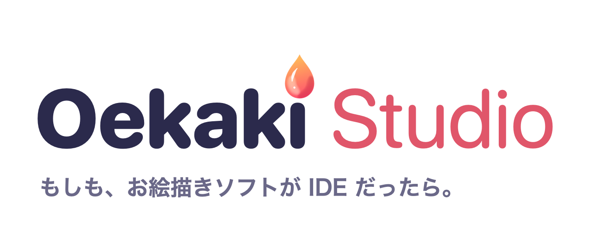
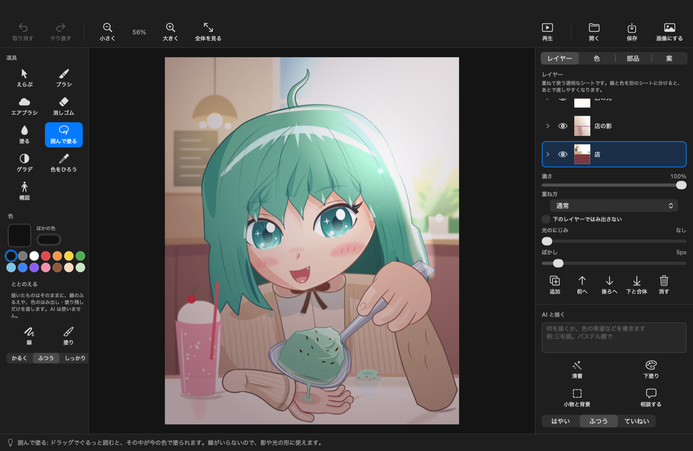
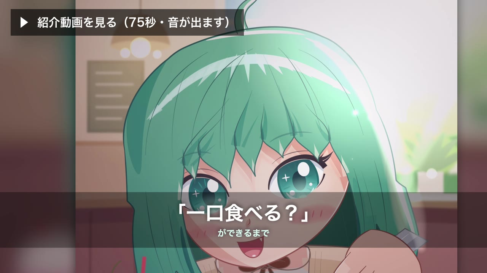
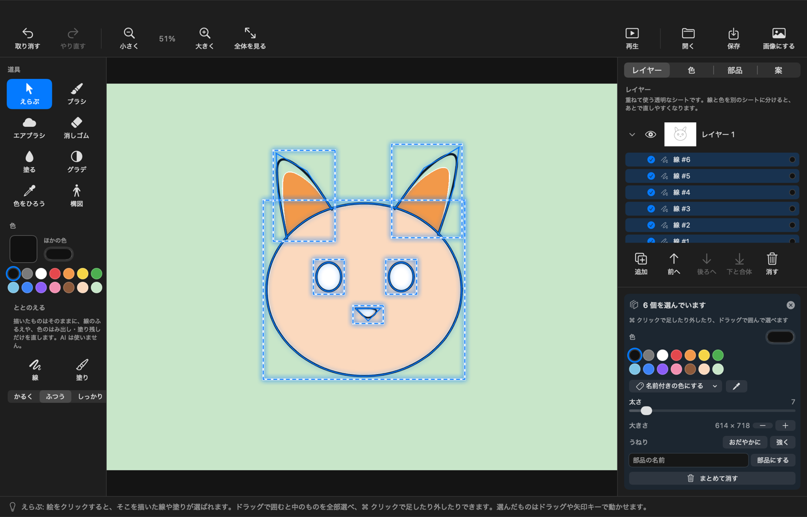
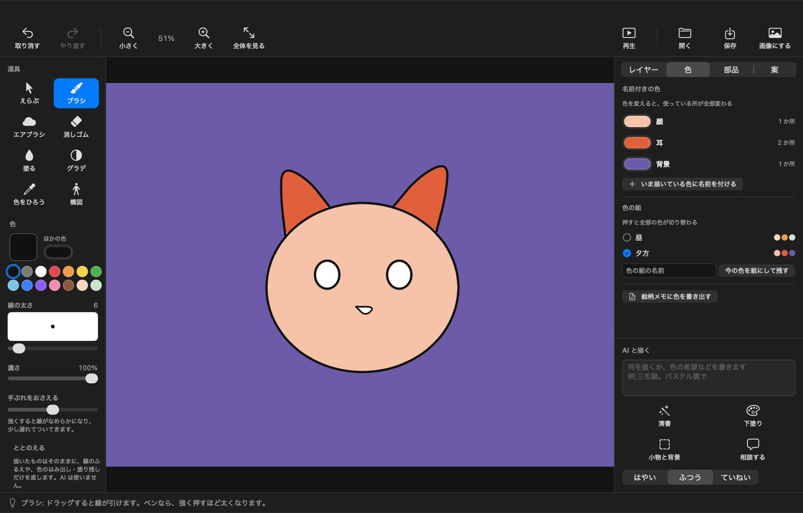
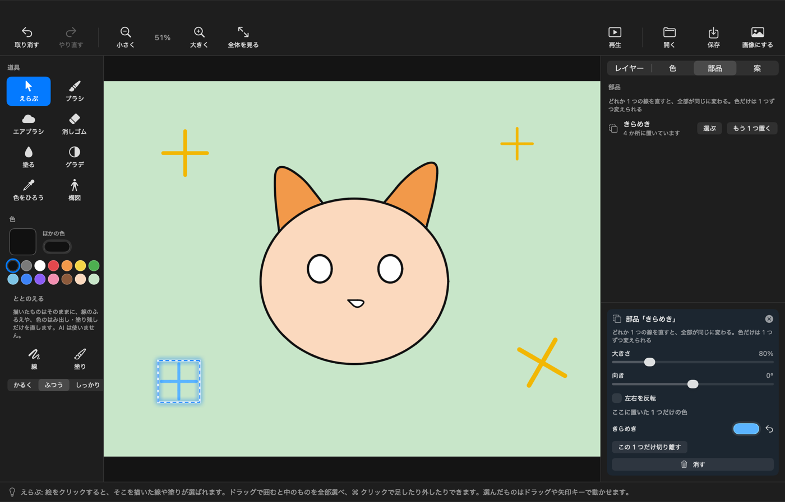
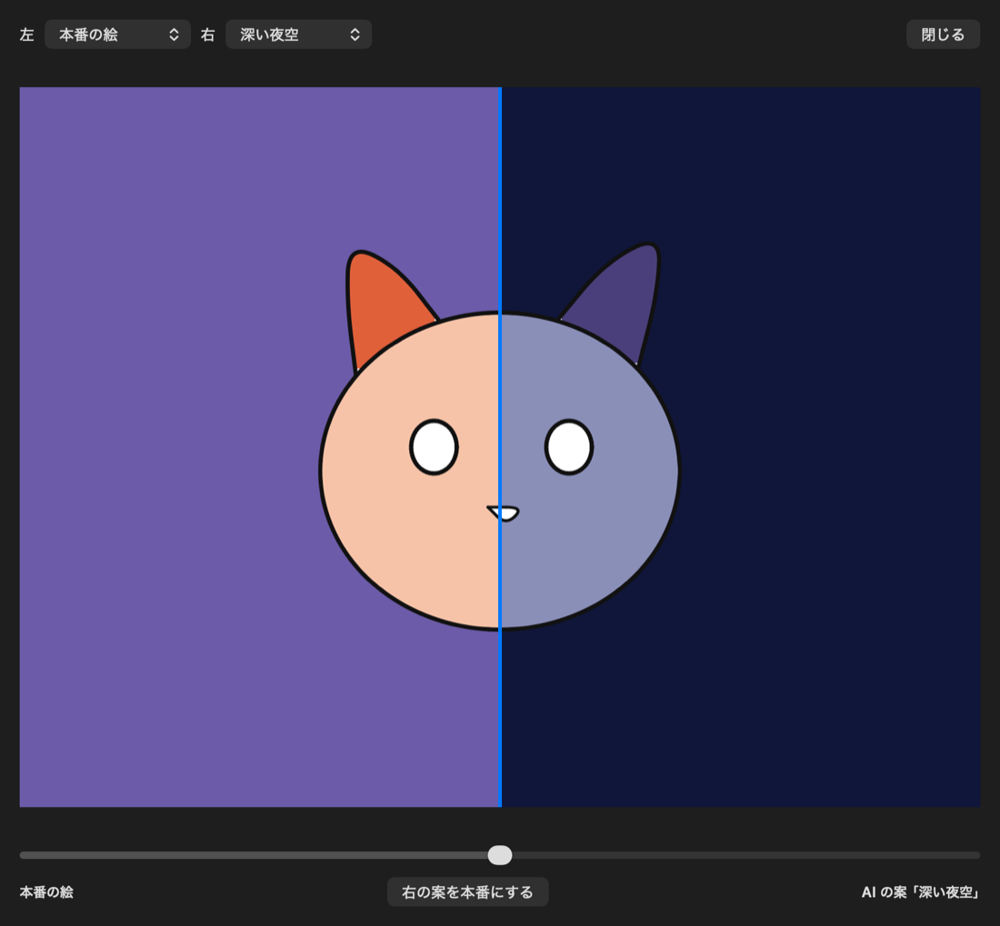
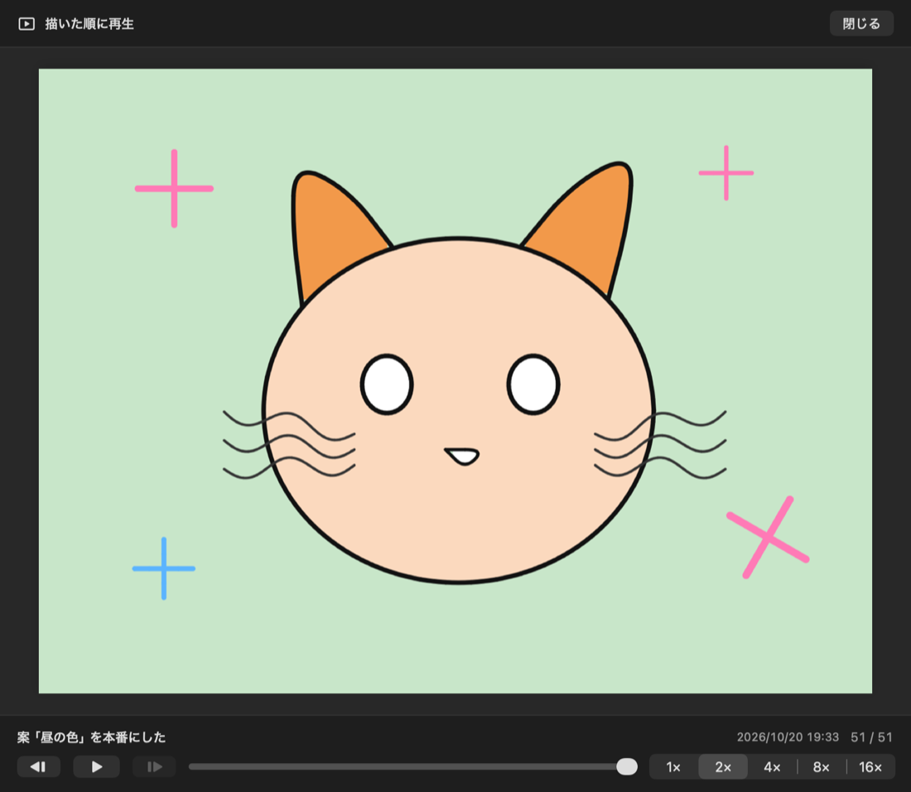
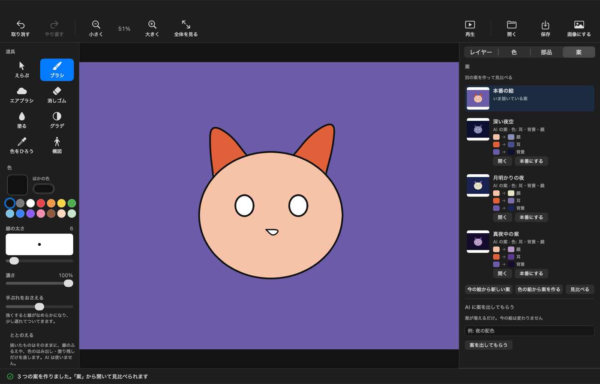
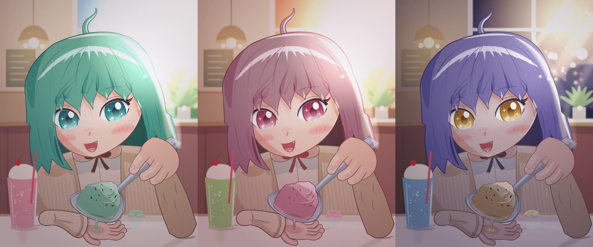

  <picture>
    <source media="(prefers-color-scheme: dark)" srcset="brand/logo-wordmark-dark.png">
    
  </picture>

  

**Oekaki Studio（おえかきスタジオ）** は、Mac で使うお絵描きアプリです。

描いた線や塗りが、1 つずつ「手順」として残ります。だから、あとから選んで直したり、描いた順に再生したり、色違いの案を作って見比べたりできます。

主役は描く人です。AI は、となりで手伝うアシスタントで、勝手に絵を書き換えません（使わなくても描けます）。人が描いた線も、AI に手伝ってもらったところも、すべて手順として残るので、何をどう変えたかをあとから確かめて直せます。最初から再生すれば、同じ絵ができるまでをもう一度たどれます。

> **IDE ってなに？**
>
> プログラマーがプログラムを書くときに使う道具です。書いたものを 1 行ずつ管理して、いつでも戻したり、見比べたり、続きを提案してもらったりできます。Oekaki Studio は、その便利な仕組みを、お絵描きの言葉で使えるようにしました。

  

## ダウンロード

### [OekakiStudio.zip をダウンロード（無料）](https://github.com/soyukke/oekaki-studio/releases/latest/download/OekakiStudio.zip)

- **使える Mac**: Apple シリコン（M1 以降）の Mac、macOS 14 Sonoma 以降
- zip の中には、アプリと、下の作例の絵（サンプル）が入っています。
- 前のバージョンや変更点は [Releases](https://github.com/soyukke/oekaki-studio/releases) のページにあります。

### はじめて開くとき

このアプリは Apple の確認（公証）を受けていないため、最初の 1 回だけ、次の手順で開いてください。

1. ダウンロードした zip をダブルクリックすると、フォルダが 1 つできます。その中の「OekakiStudio」を「アプリケーション」フォルダに移します。
2. 「OekakiStudio」をダブルクリックします。「開いていません」「開けません」といった確認が出たら、「完了」か「OK」を押して閉じます。
3. アップルメニューから「システム設定」→「プライバシーとセキュリティ」を開き、下のほうにある「このまま開く」を押します。
4. もう一度確認が出たら「開く」を押し、Mac のパスワード（または Touch ID）で許可します。

2 回目からは、ふつうにダブルクリックで開けます。

## できること

### 描いたものを、あとから選んで直す

絵をクリックすると、そこを描いた線や塗りが選ばれます。ドラッグで囲めば、まとめて選べます。選んだものは、色や太さを変えたり、動かしたりできます。

### 色に名前をつけて、まとめて変える

「顔」「背景」のように色に名前をつけると、その色を使っている所がいっしょに変わります。色の組み合わせを「昼」「夕方」のように残しておけば、押すだけで切り替えられます。

### 同じ形を「部品」にして使い回す

きらめきのように何度も描く形は、部品にしておけます。1 つを直すと、全部が同じに変わります。色だけは 1 つずつ変えられます。

### 別の「案」を作って見比べる

今の絵はそのままに、色違いなどの案をいくつでも作れます。2 つを左右に並べて見比べ、気に入ったほうを本番の絵にできます。

### 描いた順に再生する

はじめの 1 本から、描いた順に再生できます。速さは 1〜16 倍です。取り消しとやり直しもいつでもできるので、安心して試せます。

### AI アシスタント（使わなくても描けます）

AI に色の案を出してもらったり、ラフを清書してもらったり、下塗りや小物・背景を頼んだりできます。今の絵を見て、次にやることを相談することもできます。

AI は勝手に絵を書き換えません。いつも「案」として出てくるので、使うかどうかは自分で決められます。使うための準備は、[AI アシスタントを使うには](#ai-アシスタントを使うには) を見てください。

### そのほか

- **道具**: ブラシ、エアブラシ、消しゴム、塗りつぶし、囲んで塗る、グラデーション、色をひろう（スポイト）
- **レイヤー**: 重ね方（暗く重ねる＝乗算 など）、下のレイヤーからはみ出さない（クリップ）、ぼかし、光のにじみ
- **ととのえる**: 描いた形はそのままに、線のふるえや塗りのはみ出しだけを直します（AI は使いません）
- **構図**: 人の形のアタリ（ポーズや顔の向きを変えられます）を置いて、それをもとに描けます
- **描き心地**: 手ぶれ補正。ペンタブレットなら、強く押すほど線が太くなります
- **トラックパッド**: 2 本指でタップすると取り消し、3 本指でタップするとやり直し
- **保存**: 手順ごと残る専用のファイル（.oekakistudio）で保存します。ダブルクリックで開けます。「画像にする」で PNG 画像にも書き出せます
- **言葉**: 画面は日本語と英語。Mac の言語設定に合わせて切り替わります

## 作例

「一口食べる？」（ミントの昼 / いちごの夕方 / 夜のバニラ）

この絵は、人が言葉で指示し、AI が描画のプログラムを書いて描きました。いわゆる「バイブコーディング」です。Oekaki Studio の絵は手順（コード）でできているので、こういう描き方もできる、という一例にすぎません。アプリの AI 機能で描いたものではありません。アプリそのものは、人が主役になって描き、AI がアシスタントとして手伝う使い方を目指して作っています。

ダウンロードした zip の中の「サンプル」フォルダにあるファイルをダブルクリックすると、Oekaki Studio で開きます。「再生」を押し、出てきた画面で ▶ を押すと、白い紙から描かれていくようすを見られます。レイヤーや、1 本ずつの線も開いて直せます。

| 作ったもの | 作った AI | 時期 |
|---|---|---|
| 絵「一口食べる？」 | Claude Opus 5.5（Anthropic） | 2026 年 10 月 |
| 紹介動画 | Claude Opus 5.5（Anthropic） | 2026 年 10 月 |

作例と紹介動画は、今後ほかの AI で作り直すことがあります。そのときは、この表に書き足していきます。

## AI アシスタントを使うには

AI の機能は、Anthropic 社の「Claude Code」を通して動きます。AI を使わないなら、準備はいりません。

1. Claude Code を Mac に入れます。入れ方と、使えるプランは [Claude Code の公式の案内](https://code.claude.com/docs/ja/setup) を見てください。
2. Oekaki Studio の AI の欄に「ログインする」が出ていたら押して、開いたブラウザで Claude にログインします。

AI に頼むと、そのときのキャンバスの画像と、書いた依頼の文章などが Claude（Anthropic 社）に送られます。AI の利用分は、ご自身の Claude のプランの使用量に含まれます。

## 質問・不具合・要望

- **不具合の報告や、「こうなってほしい」という要望**: [Issues](https://github.com/soyukke/oekaki-studio/issues/new/choose)
- **使い方の質問、感想、描いた絵の共有**: [Discussions](https://github.com/soyukke/oekaki-studio/discussions)

更新は不定期です。Issues や Discussions も、お返事や対応ができないことがあります。

このリポジトリでは、プルリクエスト（コードの変更の提案）は受け付けていません。急いで直したいところや、変えたいところがあれば、このリポジトリをフォーク（自分用に複製）して、[MIT ライセンス](LICENSE) の範囲で自由に改変して使ってください。

## このアプリの考え方

機能を足すときや、迷ったときに立ち返る考え方を [PHILOSOPHY.md](PHILOSOPHY.md) にまとめています。

## 開発者の方へ

ソースコードからのビルド方法や、中のしくみは [DEVELOPMENT.md](DEVELOPMENT.md) にまとめています。

## ライセンス

[MIT ライセンス](LICENSE) です。コードも、作例の絵、ロゴ、紹介動画も、著作権の表示とライセンスの文を残せば、自由に使ったり変えたりできます。
